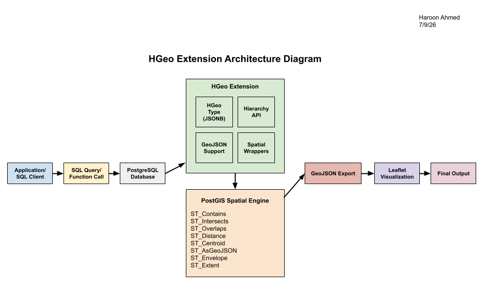

# HGeo Extension Architecture

## Overview

The Hierarchical Geography (HGeo) Extension is designed as a modular PostgreSQL extension for storing, querying, and visualizing hierarchical geographic data. The system leverages PostgreSQL for data storage, PostGIS for spatial operations, GeoJSON for data exchange, and Leaflet for interactive visualization.

The overall architecture is shown below.

---

# Component Descriptions

## Application / SQL Client

Represents any application or user issuing SQL queries to the database. Users interact with the HGeo extension through SQL functions such as `create_hgeo()`, `add_child()`, `parent()`, and `visualize()`.

---

## PostgreSQL Database

Stores HGeo objects and executes SQL queries. The database serves as the foundation for the extension and manages all persistent geographic data.

---

## HGeo Extension

The HGeo Extension is the core of the project and consists of four primary components:

### HGeo Type (JSONB)

Implements the hierarchical geography data type using a JSONB-backed representation. Each HGeo object stores geographic information, metadata, and recursively nested child regions.

### Hierarchy API

Provides functions for creating and manipulating hierarchical geographic objects, including:

- `create_hgeo()`
- `add_region()`
- `remove_region()`
- `add_child()`
- `parent()`
- `children()`

### GeoJSON Support

Provides interoperability with external GIS applications through:

- `hgeo_from_geojson()`
- `hgeo_to_geojson()`

These functions import, export, and validate GeoJSON while preserving the geographic hierarchy.

### Spatial Wrappers

Implements SQL wrappers around PostGIS spatial operations instead of reimplementing geometric algorithms.

Supported operations include:

- contains
- intersects
- overlaps
- distance
- nearest
- bounding box

---

## PostGIS Spatial Engine

The extension essentially delegates all geometric computations to PostGIS. This allows the project to leverage existing, well-tested spatial algorithms while keeping the HGeo implementation focused on hierarchical data management.

Examples include:

- `ST_Contains`
- `ST_Intersects`
- `ST_Overlaps`
- `ST_Distance`
- `ST_Centroid`
- `ST_Envelope`
- `ST_AsGeoJSON`

---

## GeoJSON Export

The `visualize()` function exports HGeo objects as a GeoJSON FeatureCollection. This GeoJSON serves as the interface between PostgreSQL and the visualization layer.

---

## Leaflet Visualization

Leaflet then renders an interactive map featuring the following:

- polygons
- point markers
- hierarchy sidebar
- popups
- parent highlighting
- color-coded hierarchy levels

---

# System Workflow

In a nutshell, the overall execution workflow is:

1. A user submits a SQL query.
2. PostgreSQL executes the requested HGeo function.
3. The HGeo extension manages the hierarchical data.
4. Spatial operations are delegated to PostGIS when needed.
5. The `visualize()` function exports the hierarchy as GeoJSON.
6. Leaflet renders the GeoJSON as an interactive map.

---

# Design Decisions/Takeaways

Several important design decisions guided the implementation of the HGeo Extension:

- **JSONB** was selected to naturally represent recursive hierarchical geographic objects.
- **PostGIS** performs all spatial computations, avoiding the need to implement geometry algorithms from scratch.
- **GeoJSON** provides a standard exchange format between PostgreSQL and the visualization layer.
- **Leaflet** was chosen as a lightweight mapping framework capable of directly rendering GeoJSON.
